# Which visual properties matter in AV explanation displays

A crowdsourced study to decide which visual properties of an automated-vehicle (AV) explanation display are worth
personalising. Participants watch real dashcam clips with an explanation display drawn on top, rank the display's
properties and compare clips that differ in one property. A pre-registered rule then selects up to four properties on
which people hold stable, different preferences, and fixed values for everything else. A follow-up preference
optimisation tunes only those.

<p align="center">
  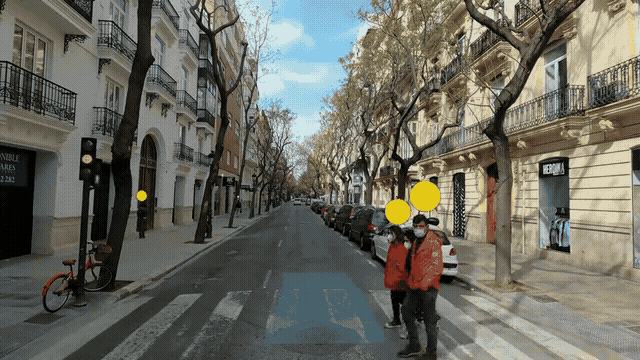
  <br><em>The default display in one of the 19 scenes: the car's planned path, and markers above the pedestrians it
  reacts to.</em>
</p>

The crowdsourcing setup follows [bazilinskyy/ehmi-vehicles](https://github.com/bazilinskyy/ehmi-vehicles): a
[jsPsych](https://www.jspsych.org) 8 experiment served by Node.js (Express), with the analysis in Python.

**Contents:** [How it works](#how-it-works) · [The properties](#the-properties) · [The scenes](#the-scenes) ·
[What participants do](#what-participants-do) · [Making the stimuli](#making-the-stimuli) ·
[Running the experiment](#running-the-experiment) · [Analysis](#analysis) · [Data and privacy](#data-and-privacy) ·
[Repository layout](#repository-layout) · [Footage](#footage)

## How it works

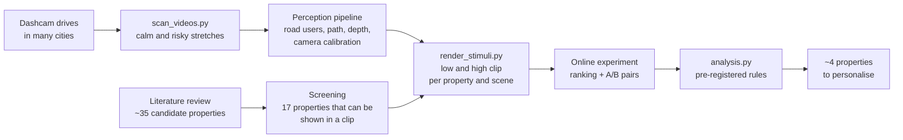

1. The literature review (`reports/AV display property literature.md`) lists the candidate properties and the
   evidence for each. Properties with consensus are fixed; those that can be shown in a video clip are screened in.
2. Scenes are cut from long dashcam drives in many cities (the CROWD dataset): one calm and one risky stretch per city.
3. A perception pipeline extracts, per frame, the road users, the car's planned path, distances and the camera
   calibration. The renderer draws the display from that geometry, once per property level, so the two clips of a
   pair differ in that one property only.
4. Participants rank the properties (Best-Worst Scaling) and compare A/B clips; the analysis applies the selection
   rules.

## The properties

`study/properties.json` lists every candidate property with its source, its levels and why it was screened in or out.
These are the 17 configurations the study checks. Each one is a single setting of the display; its two clips
(low and high) differ only in that setting, everything else stays at the default. The clips below are the ones
participants see next to each property on the ranking screens; in the A/B pairs they see the two levels as full
videos instead.

**Planned path**

| Property | What changes | Low (left) vs high (right) |
|---|---|---|
| **Path visibility**<br>`trajectory_alpha` | How strongly the car's planned path is drawn on the road.<br><br>Low: Faint<br>High: Solid | 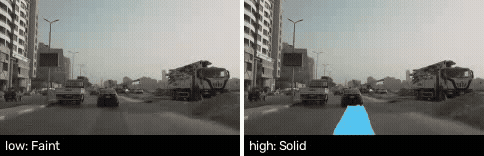 |
| **Path width**<br>`path_width` | How wide the planned path is drawn.<br><br>Low: Thin line<br>High: Car-wide band | 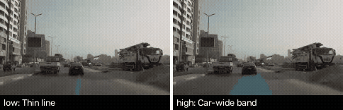 |
| **Path length**<br>`path_length` | How far ahead the planned path is shown.<br><br>Low: Short (about 8 m)<br>High: Long (about 35 m) | 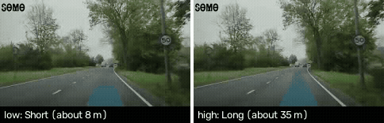 |
| **Path style**<br>`path_style` | Whether the path is a plain band or carries arrows that flow forward.<br><br>Low: Plain band<br>High: Flowing arrows | 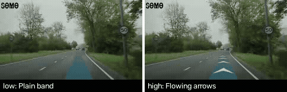 |
| **Path certainty colour**<br>`path_uncertainty` | Whether the path changes colour further ahead, where the car is less certain.<br><br>Low: One colour<br>High: Colour changes with distance | 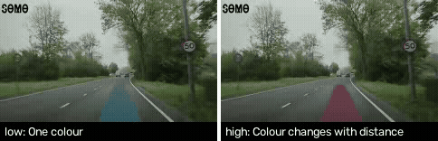 |

**Planned manoeuvre**

| Property | What changes | Low (left) vs high (right) |
|---|---|---|
| **Manoeuvre cue**<br>`manoeuvre_cue` | An icon and short text naming the car's next manoeuvre.<br><br>Low: None<br>High: Icon and text, e.g. 'Turning left' | 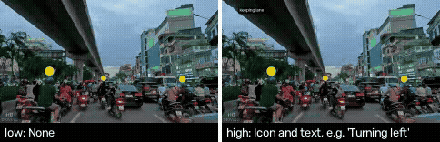 |

**Road users**

| Property | What changes | Low (left) vs high (right) |
|---|---|---|
| **Highlight strength**<br>`mask_alpha` | How strongly the road users the car reacts to are highlighted.<br><br>Low: Subtle<br>High: Strong | 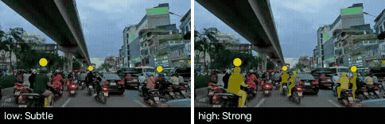 |
| **Which road users are highlighted**<br>`highlight_scope` | Only the road users the car reacts to, or every road user it detects.<br><br>Low: Only those the car reacts to<br>High: All detected | 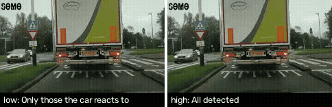 |
| **Highlight style**<br>`highlight_style` | How the road users are marked.<br><br>Low: Outline<br>High: Filled shape | 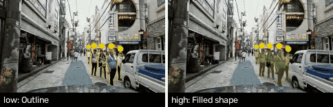 |
| **Colour by road-user type**<br>`class_colours` | Whether pedestrians and vehicles are highlighted in different colours.<br><br>Low: One colour for all<br>High: Different colour per type | 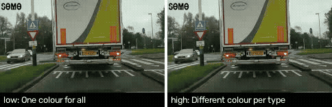 |
| **Pedestrian marker size**<br>`marker_size` | Size of the marker above pedestrians.<br><br>Low: Small<br>High: Large | 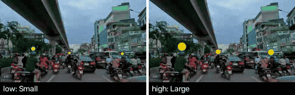 |
| **Other road users' paths**<br>`predicted_paths` | Lines showing where moving road users are heading.<br><br>Low: Off<br>High: On | 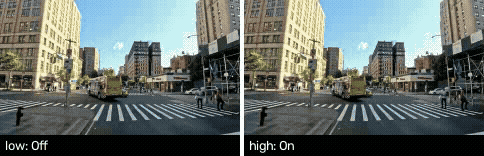 |

**Text**

| Property | What changes | Low (left) vs high (right) |
|---|---|---|
| **Explanation detail**<br>`explanation_detail` | How much the display says about why the car acts.<br><br>Low: None<br>High: e.g. 'Stopping: pedestrians crossing' | 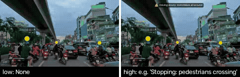 |

**Timing**

| Property | What changes | Low (left) vs high (right) |
|---|---|---|
| **When the display is shown**<br>`show_when` | Only around the event, or for the whole drive.<br><br>Low: Only around the event<br>High: Always | 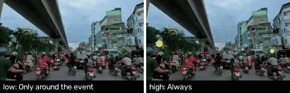 |

**Vehicle state**

| Property | What changes | Low (left) vs high (right) |
|---|---|---|
| **Confidence indicator**<br>`confidence_indicator` | A bar showing how confident the car is about what it sees.<br><br>Low: None<br>High: Confidence bar | 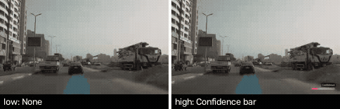 |

**Context**

| Property | What changes | Low (left) vs high (right) |
|---|---|---|
| **Background dimming**<br>`background_dim_alpha` | How much the parts of the scene that do not matter are darkened.<br><br>Low: None<br>High: Strong | 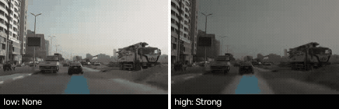 |

**Colour**

| Property | What changes | Low (left) vs high (right) |
|---|---|---|
| **Colour palette**<br>`palette_id` | The set of colours used for the whole display.<br><br>Low: Standard (yellow and cyan)<br>High: Another palette: colour-blind friendly, minimal, or high-contrast | 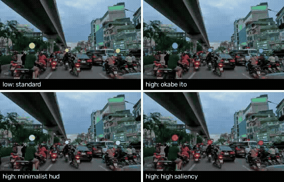 |

Nine of the properties are tunable (continuous: path visibility, width, length and certainty colour, highlight
strength, marker size, background dimming; ordinal: explanation detail, confidence indicator) and can be selected for
the optimisation. The other eight are categorical (on/off or a choice between styles) and are settled by the majority
preference. Each is tested at two levels, so the study shows whether a property is worth tuning, not where within its
range people's preferences lie.

Four of these are the parameters of the follow-up preference study (highlight strength, path visibility, background
dimming and colour palette), with the same ranges and defaults, so that study's choice of parameters can be checked
against what participants rank here. The palette has three alternatives to the standard one; each participant sees
one of them, at random.

Not in the study: distance labels, a status panel and the panel position are kept as reserves; placement, audio,
on-demand display, explanation timing, path shape and text size are fixed or excluded, with the reason in
`properties.json`.

## The scenes

Nineteen 14-second scenes: one calm and one risky stretch from each of eight cities on four continents, plus three
earlier scenes from the USA and Egypt. Each scene records its country (to compare clips from a participant's own country with
clips from elsewhere) and its criticality (to compare calm and risky situations).

<p align="center">
  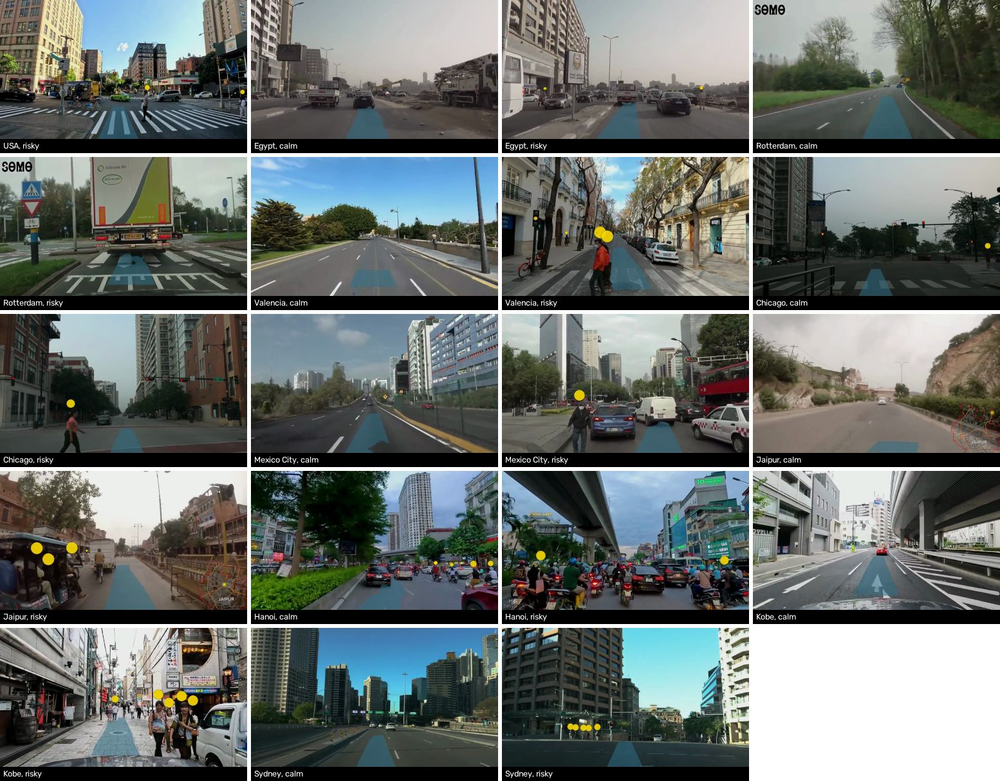
</p>

| Scene | City | Country | Risk | Source (start) |
|---|---|---|---|---|
| `pedestrian_crossing` | – | USA | risky | [TuCsyBF3nHU at 77:11](https://www.youtube.com/watch?v=TuCsyBF3nHU&t=4631s) |
| `braking_in_traffic` | – | Egypt | calm | [Esyp2P0uJu4 at 4:48](https://www.youtube.com/watch?v=Esyp2P0uJu4&t=288s) |
| `unexpected_obstacle` | – | Egypt | risky | [Esyp2P0uJu4 at 4:36](https://www.youtube.com/watch?v=Esyp2P0uJu4&t=276s) |
| `rotterdam_calm` | Rotterdam | Netherlands | calm | [m9M4MYI_tAY at 16:22](https://www.youtube.com/watch?v=m9M4MYI_tAY&t=982s) |
| `rotterdam_risky` | Rotterdam | Netherlands | risky | [m9M4MYI_tAY at 42:27](https://www.youtube.com/watch?v=m9M4MYI_tAY&t=2547s) |
| `valencia_calm` | Valencia | Spain | calm | [G7wQRZ3nopk at 40:18](https://www.youtube.com/watch?v=G7wQRZ3nopk&t=2418s) |
| `valencia_risky` | Valencia | Spain | risky | [G7wQRZ3nopk at 44:19](https://www.youtube.com/watch?v=G7wQRZ3nopk&t=2659s) |
| `chicago_calm` | Chicago | USA | calm | [XzwI2rGmf04 at 11:56](https://www.youtube.com/watch?v=XzwI2rGmf04&t=716s) |
| `chicago_risky` | Chicago | USA | risky | [XzwI2rGmf04 at 59:19](https://www.youtube.com/watch?v=XzwI2rGmf04&t=3559s) |
| `mexico_city_calm` | Mexico City | Mexico | calm | [MpA3FHZ3yZc at 39:34](https://www.youtube.com/watch?v=MpA3FHZ3yZc&t=2374s) |
| `mexico_city_risky` | Mexico City | Mexico | risky | [MpA3FHZ3yZc at 2:44](https://www.youtube.com/watch?v=MpA3FHZ3yZc&t=164s) |
| `jaipur_calm` | Jaipur | India | calm | [jwZV8i60Sbs at 14:14](https://www.youtube.com/watch?v=jwZV8i60Sbs&t=854s) |
| `jaipur_risky` | Jaipur | India | risky | [jwZV8i60Sbs at 1:34](https://www.youtube.com/watch?v=jwZV8i60Sbs&t=94s) |
| `hanoi_calm` | Hanoi | Vietnam | calm | [AKaJkDqrOjU at 6:08](https://www.youtube.com/watch?v=AKaJkDqrOjU&t=368s) |
| `hanoi_risky` | Hanoi | Vietnam | risky | [AKaJkDqrOjU at 8:17](https://www.youtube.com/watch?v=AKaJkDqrOjU&t=497s) |
| `kobe_calm` | Kobe | Japan | calm | [TJjqYeYyIoE at 10:36](https://www.youtube.com/watch?v=TJjqYeYyIoE&t=636s) |
| `kobe_risky` | Kobe | Japan | risky | [TJjqYeYyIoE at 24:16](https://www.youtube.com/watch?v=TJjqYeYyIoE&t=1456s) |
| `sydney_calm` | Sydney | Australia | calm | [wMu6Va5PhGY at 4:06](https://www.youtube.com/watch?v=wMu6Va5PhGY&t=246s) |
| `sydney_risky` | Sydney | Australia | risky | [wMu6Va5PhGY at 31:46](https://www.youtube.com/watch?v=wMu6Va5PhGY&t=1906s) |

`study/scenes.json` also holds each scene's explanation texts; `texts_verified` stays false until someone has checked
them against the clip.

## What participants do

The study takes about 30 minutes, on a computer (phones, tablets and screens below 1280 × 720 px cannot take part).

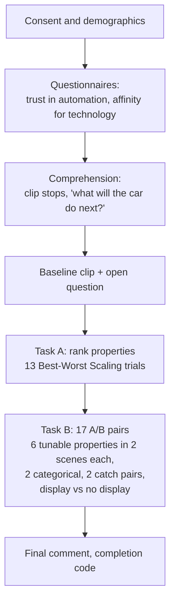

1. **Consent and demographics:** age, nationality and country of residence, gender, driving licence, car use,
   experience with driver assistance and self-driving cars, familiarity with head-up displays, colour vision.
2. **Questionnaires** (`study/questionnaires.json`): propensity to trust automation (Körber 2019, 3 items) and
   affinity for technology interaction (ATI, Franke et al. 2019, 9 items), to test whether preferences split by user
   type.
3. **Comprehension:** one clip per scene with a question, at a random level of one property. The clip stops before the
   car acts and the participant answers "What will the car do next?", before any property is named.
4. **Open question (Task C):** a baseline clip, then "What would you want this display to show, or show differently?"
5. **Ranking (Task A):** Best-Worst Scaling. Each trial shows 4 properties; the participant picks the most and least
   important for understanding what the car is doing and why. Each property comes with a looping preview of its two
   levels side by side, so it is judged from what it looks like and not only from its name.
6. **A/B pairs (Task B):** the same situation with a property at its low and high level (sides randomised): did you
   notice a difference, which display would you prefer while riding (A clearly, A slightly, no preference, B slightly,
   B clearly), and how much does the difference matter (1–7). Each participant compares 6 of the 9 tunable properties,
   **each in two different scenes**, so that their two answers show whether they hold a stable preference or do not
   care; and 2 of the 8 categorical properties in one scene. Mixed in: **2 catch pairs** with the same clip on both
   sides (reporting a difference there is a false alarm) and the display vs the same clip without a display.
7. Five attention checks between the trials; three wrong answers end the study, with a partial payment.

<table>
  <tr>
    <td width="45%">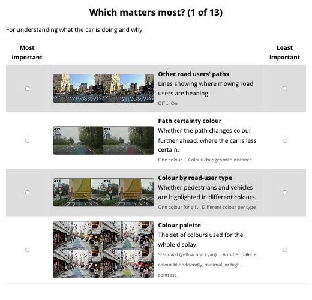</td>
    <td width="55%">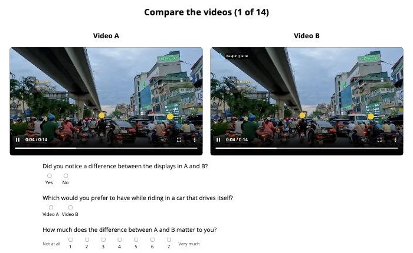</td>
  </tr>
  <tr>
    <td><em>Task A: a ranking trial.</em></td>
    <td><em>Task B: an A/B pair (here: the manoeuvre cue in Hanoi).</em></td>
  </tr>
</table>

<p align="center">
  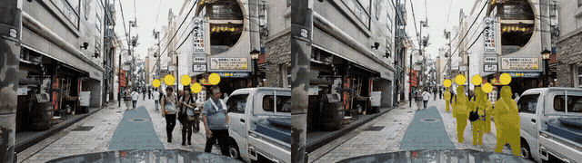
  <br><em>A ranking preview: highlight strength, subtle (left) and strong (right).</em>
</p>

Data is saved after every trial, so the answers of participants who stop early are kept. The order of trials, the BWS
version (50 balanced versions), the scene per property and the side of each level are seeded with the participant's
code.

## Making the stimuli

The clips are made, not filmed: a real dashcam clip with the display drawn on top by `avprops/clip_render.py`. Every
property is a parameter of that renderer, and each property in `properties.json` has a `render` block with the
settings of its low and high clip; everything else stays at the `baseline`. Source clips (`data/clips/`), geometry and
rendered clips (`public/stimuli/`) are not in git.

**Finding scenes.** `scan_videos.py` decodes each long drive at 2 frames per second, detects road users with YOLO and
scores every 14 s window by how close and central the road users ahead are (pedestrians, cyclists and motorcyclists
weigh 1.5 times as much). It leaves out windows with a cut, dark windows and, with `--segments`, anything outside the
stretches the dataset's mapping lists as car driving in the locality, and writes the calmest and riskiest windows
with a strip of frames to review. The score is a screen, not a measure of danger, so every scene is chosen by eye.

```bash
uv run --extra extract python scan_videos.py VIDEOS... --segments segments.csv --device cuda:0
```

**Geometry.** The renderer draws from per-frame overlay geometry: the planned path, the road users with outlines,
boxes, distances and track ids, an occlusion map and the explanation ramp (format documented in
`avprops/clip_render.py`). The scenes use geometry from a perception pipeline (`data/geometry_pipeline/`): YOLO26x
segmentation with ByteTrack, SegFormer road segmentation, Depth Anything V2 distances, a camera auto-calibration per
clip, and a planned path anchored to the road from visual odometry of the car's actual motion. A scene's `camera` is
only given where the auto-calibration found none. `extract_geometry.py` is a simpler fallback (YOLO segmentation,
ByteTrack and a straight path in the car's lane).

**Rendering.**

```bash
uv sync --extra extract                                  # detection and tracking dependencies
uv run python extract_geometry.py --device mps           # fallback geometry (cuda:0 on a GPU host)
uv run python render_stimuli.py --calibrate              # check each scene's camera constants
uv run python render_stimuli.py --preview                # a still of every clip, as a contact sheet
uv run python render_stimuli.py --check                  # how much each pair differs in each scene
uv run python make_design.py                             # uses the check to pick scenes per property
uv run python render_stimuli.py                          # the clips, as H.264, into public/stimuli/
uv run python render_stimuli.py --previews               # the ranking previews, from the rendered clips
uv run python make_design.py                             # again, so the design lists the previews
uv run python make_figures.py                            # the figures in this README
```

**The rendered files.** `public/stimuli/` (not in git) has 20 folders: one per scene (19) and `previews/`.

```
public/stimuli/
├── hanoi_risky/                         one folder per scene, 38 clips each
│   ├── baseline.mp4                     the default display
│   ├── none.mp4                         the same clip without a display
│   ├── trajectory_alpha_low.mp4         low and high clip of each property
│   ├── trajectory_alpha_high.mp4
│   ├── ...                              (16 properties x 2)
│   ├── palette_id_low.mp4               the standard palette
│   ├── palette_id_high_okabe_ito.mp4    and its three alternatives
│   ├── palette_id_high_minimalist_hud.mp4
│   └── palette_id_high_high_saliency.mp4
├── valencia_calm/ ... (18 more scenes)
└── previews/                            17 short side-by-side clips for the ranking screens
```

Each scene folder holds 1 baseline + 1 no-display clip + 16 properties × 2 levels + the palette's 4 versions = 38
clips, so every property can be shown in every scene. The study uses fewer: each property's A/B pair uses 4 scenes
(below), so participants see 180 of the 722 clips, and only those are deployed. Clips are drawn at 1280 × 720 and
delivered at 960 × 540 (about 35 MB per participant); `render_stimuli.py --reencode` shrinks clips rendered before
that.

**Which scenes a property uses.** A property can only differ in a scene that has what it acts on: other road users'
paths need people moving sideways, colour by type needs vehicles, "when shown" needs an event with a few seconds
before it. `--check` measures, per scene, the share of pixels that differ between the low and high clip and flags
pairs below 0.2% as `WEAK`; `make_design.py` then lets each property's A/B pair use only the scenes where it passed,
at most 4 per property (`ab_max_scenes_per_property`), chosen to mix calm and risky scenes and countries.
Because the pipeline's path covers only where the car actually drives, the path properties pass mostly in scenes
where the car moves; the highlight properties act on pedestrians and pass mostly in the risky scenes. Both limit how
far the calm vs risky comparison can be read for those properties.

After any change to the properties, scenes or settings, regenerate the design (`public/design.json`):

```bash
uv run python make_design.py
```

## Running the experiment

```bash
npm install
npm start                                                # http://localhost:3000
```

Responses are appended to `data/entries.jsonl`, or to the file named by `DATA_FILE`. With `CONNECTION` set to a
MongoDB connection string they go to MongoDB instead, as in ehmi-vehicles.

URL parameters:
* `debug=true`: log to the browser console, skip the device check, allow continuing before a video ends, show the
  names of missing clips, and mark the data as debug (excluded from the analysis).
* `skip_to=tasks` (with `debug=true`): start at the ranking and A/B tasks.
* `save_data=false`: do not send data to the server.
* `worker_code=<code>`: participant code to store with the data and show on the finish page. `PROLIFIC_PID` is used
  when present; otherwise a random 14-character code is made.
* `platform=<name>`: recruitment platform, stored with the data (e.g. `platform=microworkers`).

**Hosting.** As in ehmi-vehicles, the live study runs on Heroku (`Procfile`, Node.js 22) with the responses in
MongoDB (the `CONNECTION` config variable). The clips are not in git (third-party footage), so instead of deploying
from GitHub, `deploy/heroku.sh` pushes the committed code together with only the clips the design needs (about
250 MB, under Heroku's 500 MB limit) straight to the Heroku app:

```bash
heroku login
heroku create <app> && heroku buildpacks:set heroku/nodejs -a <app>
heroku config:set CONNECTION='<MongoDB connection string>' -a <app>
deploy/heroku.sh <app>                                   # DRY_RUN=1 to only build and report the size
```

On Heroku the participant's IP address comes from the router. [`deploy/README.md`](deploy/README.md) describes the
alternative of a server of our own (systemd and nginx, responses written to a file, no database).

**Recruitment on Microworkers.** Give the campaign the link `https://<server>/?platform=microworkers` and ask for the
completion code as proof. The link carries no worker ID: every participant gets a random code, which the finish page
shows (and the attention-fail page too, for the partial payment), so only Microworkers can link a code to a worker. To
approve submissions:

```bash
uv run python payments.py --data /srv/study-data/entries.jsonl --check CODE1 CODE2 ...
```

`payments.csv` lists every code as `full` (reached the end), `partial` (stopped by the attention checks) or `none`,
with a `review` column of quality flags (answered too fast, same IP address as an earlier participant, incomplete
data) for the researcher to decide on by hand; no payment is refused automatically. `incomplete data` on a `full`
code means the record lacks trials: rows lost on the way, or rows sent to the server by hand to fake a completion.
Delete `payments.csv` once everyone is paid.

**Sample.** To compare regions, run one campaign per region with the platform's country targeting and its own quota,
and keep the groups roughly equal. Leave out countries where the data may not be processed (see the data management
plan).

## Analysis

The analysis is in the `avprops` package, started by `analysis.py`. Tested with Python 3.12.13 and
[`uv`](https://docs.astral.sh/uv/):

```bash
uv sync
uv run python analysis.py --data data/entries.jsonl
```

### Outputs
Outputs go to `_output/` (not in git, as they hold personal data):
* `participants.csv`: every participant: finished, attention answers, questionnaire scores, false alarms in the catch
  pairs, whether they preferred no display, comprehension, excluded and why. IP addresses appear only as placeholders
  (0.0.0.1, 0.0.0.2, ...).
* `summary.csv`: per property its type, the BWS score with bootstrap CI, noticing (raw and minus the false-alarm
  rate), the preference split (high, low, none) and majority, importance, the heterogeneity H, the score, the
  probability of being selected, comprehension after the low vs the high clip (Fisher's exact test), the correlation
  of choosing the high level with each questionnaire score, and its status.
* `subgroups.csv`: per property, noticing and preference in calm vs risky scenes, in clips from the participant's own
  country vs elsewhere, and (colour-dependent properties) with vs without a colour vision deficiency.
* `open_answers.csv` (for thematic coding of Task C) and `report.md`, with the selected properties and where every
  other one stopped.

### Selection rule
The rule follows the review by Mark Colley (2026-11-09). A property worth personalising is one that people notice,
consider important, and on which they hold **stable, different** preferences: a 50/50 split alone cannot tell that
from people who do not care.

1. **Tunable only.** Continuous and ordinal properties (`type` in `properties.json`) can be tuned by the follow-up
   optimisation. Categorical ones (on/off, a choice between styles) are settled by the majority preference instead.
2. **Noticed.** The share who noticed the difference, minus the false-alarm rate from the catch pairs, is at least
   `noticed_min_share` (70%).
3. **People differ.** The heterogeneity H is the intraclass correlation of a participant's choices in the two scenes
   (participants who chose a level in both). It is about 0 when people do not care or all prefer the same level, and
   about 1 when they hold stable, opposite preferences. It must be at least `heterogeneity_min` (0.30).
4. **Ranked.** Among the remaining properties, importance (the BWS score rescaled to 0..1) × H ranks them, and the top
   `select_n` (4) are selected; fewer if fewer qualify. A bootstrap over participants gives each property's
   probability of being selected, reported next to the choice.

Every property gets a status: `selected`, `eligible, below cut-off`, `people agree: fix at low/high`, `categorical:
settle at low/high` or `not noticed`.

**Error rates and sample size.** `simulate.py` builds populations with properties of three kinds (consensus, two
stable user types, indifference), indifferent responders, a redundant pair and false alarms, and computes the right
answer from a large virtual population. Across 80 simulated studies per size, each with a new population:

| Usable participants | Picked a wrong property | Clearly wrong (far from every cut-off) | Missed a right one | Exactly right |
|---|---|---|---|---|
| 300 | 45% | 20% | 10% | 51% |
| 450 | 26% | 6% | 12% | 62% |
| 600 | 18% | 5% | 8% | 78% |
| 800 | 20% | 5% | 10% | 70% |
| 1000 | 18% | 4% | 14% | 71% |

The errors level off at about 600 usable participants; what remains are properties close to a cut-off. Fix the
thresholds on the pilot (under its own `study_id`), then pre-register the rule, these error rates and N.

### Configuration
Settings are read from `config`, secrets from `secret`; create them from `default.config` and `default.secret` (if
there is no `config`, `default.config` is used).
* `path_data`, `files_heroku`, `download_data`: where the data is (and, with MongoDB, whether to export it first;
  needs `mongoexport` and `mongodb_uri` in `secret`).
* `bws_items_per_trial`, `bws_appearances_per_item`, `bws_design_versions`: the BWS design.
* `ab_tunable_per_participant` (6), `ab_scenes_per_property` (2), `ab_categorical_per_participant` (2),
  `ab_catch_pairs` (2), `ab_no_display`, `ab_collect_ratings` (the three per-clip ratings; off), `comprehension`,
  `questionnaires`: the parts of the study.
* `ab_max_scenes_per_property` (4): scenes each property's A/B pair can use, picked to mix calm and risky scenes and
  countries (0 = every scene where it passed the check). Fewer scenes means fewer clips to host.
* `attention_fail_at`: wrong attention answers that end the study.
* `colour_properties_without_cvd`: leave participants with a colour vision deficiency out of the main results of
  `colour_dependent` properties (they are still compared in `subgroups.csv`).
* Exclusions: `exclude_debug`, `exclude_unfinished`, `exclude_incomplete` (a finished record must hold the consent,
  every BWS trial and every A/B pair), `attention_max_wrong`, `min_median_bws_rt_ms`, `max_catch_noticed` (off),
  `max_hidden_ab_share`, and `exclude_duplicate_ip` (keep only the first participant from each IP address, as in
  [Bazilinskyy et al., 2022](https://doi.org/10.54941/ahfe1002444); only a session that ended, finished or stopped by
  the attention checks, counts as first, so a participant who reloads the page and finishes under a new code is kept).
* `study_id` and `design_versions`: records with another `study_id` are left out. When the kept participants saw more
  than one version of `design.json` (its `generated_at`), the analysis stops until `design_versions` lists the
  version(s) to analyse. Give the pilot its own `study_id`, so its data stay out of the main analysis.
* Selection rule: `select_n`, `noticed_min_share`, `heterogeneity_min`, `selection_bootstrap`.

### Testing without real data
`simulate.py` writes synthetic participants with a known truth in the same format as the server:

```bash
uv run python simulate.py --n 150
uv run python analysis.py --data data/simulated/entries.jsonl --out _output/simulated
uv run pytest
```

## Data and privacy

* **Collected:** answers and response times, age, gender, nationality, country of residence, driving experience,
  colour vision (optional), browser and screen type, and the IP address. No names, email addresses or exact locations.
* **IP addresses** are stored with the responses only to find people who take part more than once. The analysis keeps
  the first participant per address and then replaces the addresses with placeholders, as in
  [Bazilinskyy et al., 2022](https://doi.org/10.54941/ahfe1002444) ([data](https://doi.org/10.4121/19102133)).
* **Published:** `export_public.py` writes the anonymised dataset (new random participant numbers instead of the
  codes, no IP addresses, age in bands, open answers in a separate file to redact by hand):

  ```bash
  uv run python export_public.py --data /srv/study-data/entries.jsonl --out _output/public
  ```

* The participant information sheet and consent are in `public/js/study-text.js`; fill in the placeholders with the
  ethics-approved wording before the pilot.

## Repository layout

| Path | What |
|---|---|
| `study/` | properties, scenes and questionnaires (the study's content) |
| `reports/` | literature review behind the properties |
| `public/` | the experiment (`views/`, `js/`, `css/`), `design.json`, and the clips in `stimuli/` (not in git) |
| `app.js` | the server: serves the experiment and clips, stores the responses |
| `deploy/` | deployment: `heroku.sh`, or a server of our own (`README.md`) |
| `avprops/` | Python package: scanning, geometry, rendering, design, data reading, analysis, publication |
| `scan_videos.py`, `extract_geometry.py`, `render_stimuli.py`, `make_design.py` | making the stimuli and the design |
| `analysis.py`, `payments.py`, `export_public.py`, `simulate.py` | analysis, payments, publication, simulation |
| `make_figures.py`, `docs/figures/` | the figures in this README |
| `tests/` | tests (`uv run pytest`) |

## Footage

The scenes are short segments of public dashcam videos on YouTube (linked in [the scenes table](#the-scenes)); the
rights stay with their owners. The clips are used for research only and are not redistributed: this repository holds
the code to make them, and the figures above are small stills for illustration. The scene selection builds on the
CROWD dataset of dashcam drives.

## License

Code under the [MIT License](LICENSE). The footage is not covered by it (see above).
